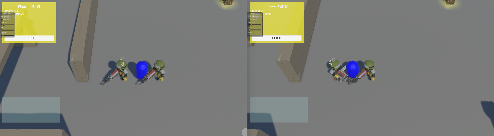
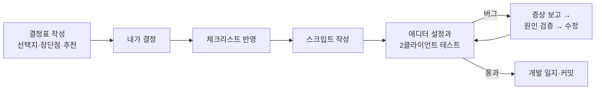
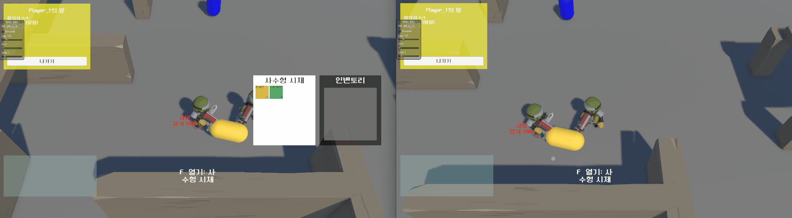
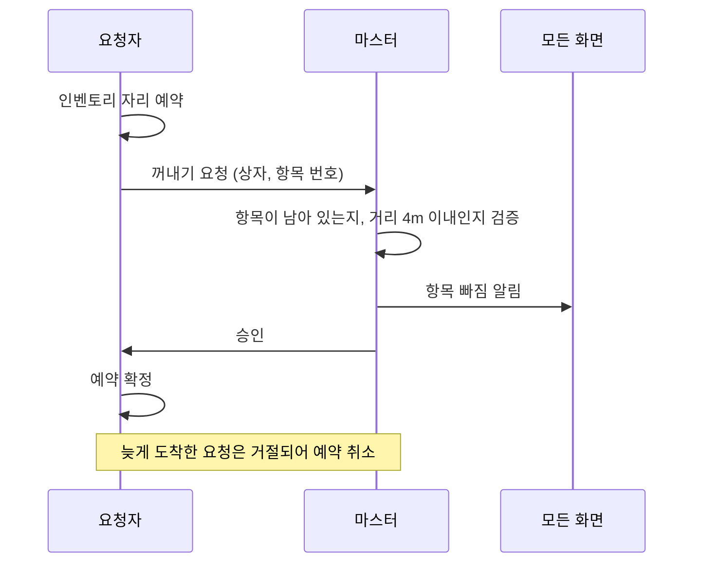
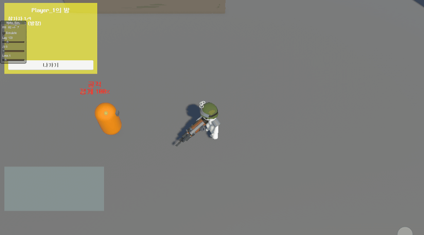
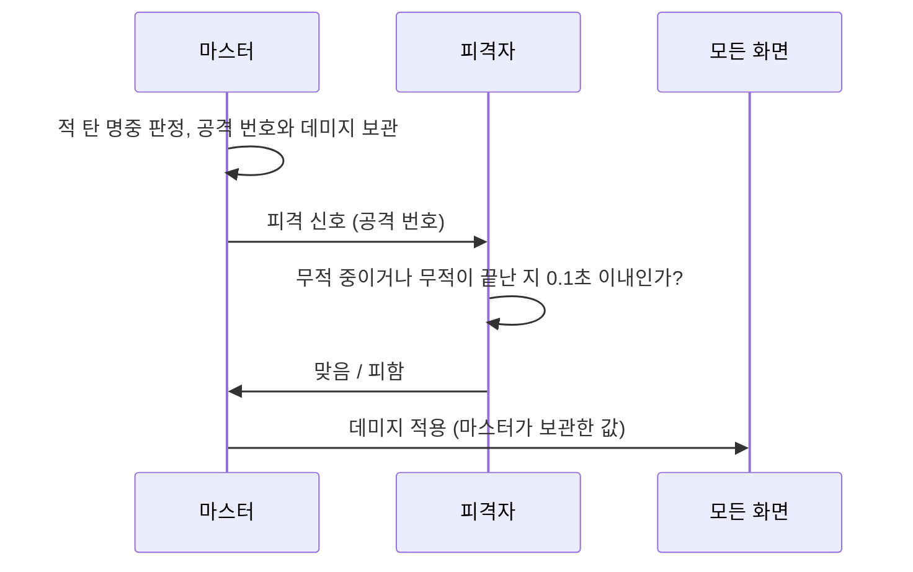
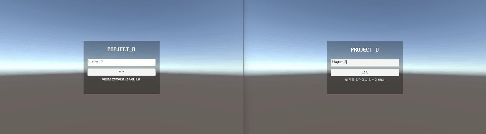
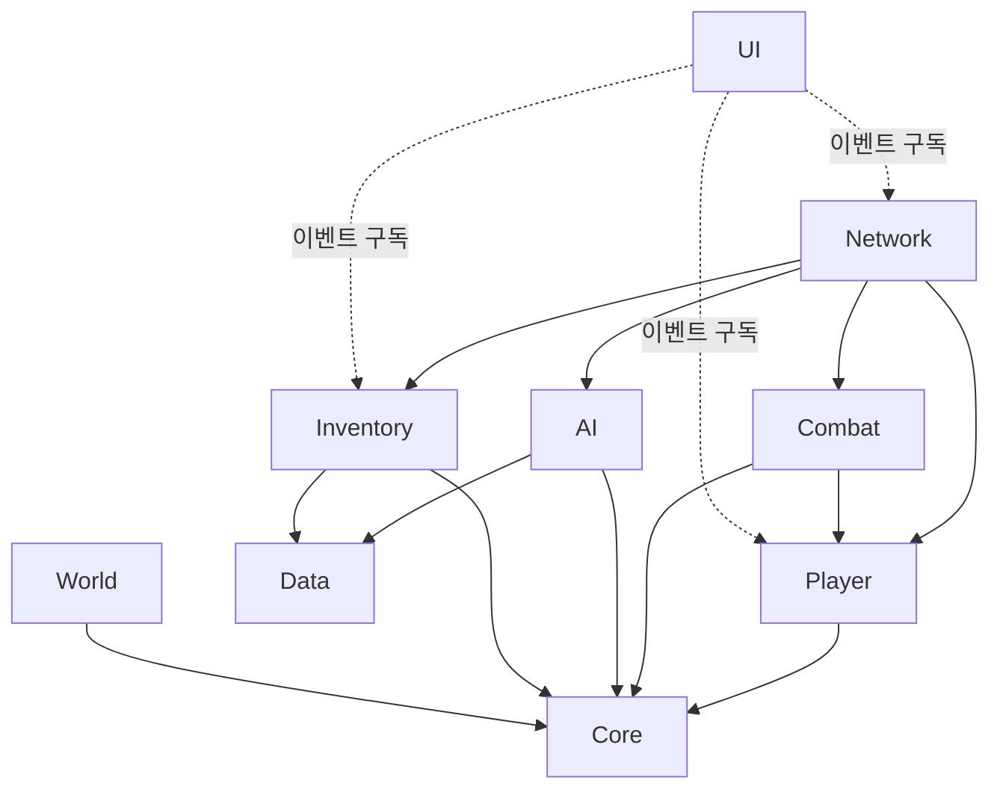
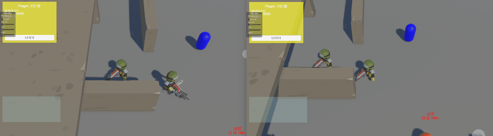
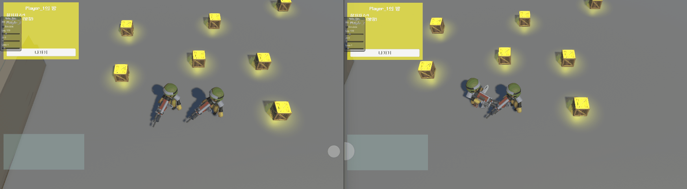

# 덕르코프 (ProjectD)
빌드 파일 : Releases 확인

**3D 쿼터뷰 협동 익스트랙션 슈터** | Unity 6 · C# · Photon PUN 2 | 1인 개발 · AI 협업

2~4명이 함께 출격해 적을 피하거나 잡고, 상자와 시체를 뒤져 아이템을 챙겨 탈출하는 게임입니다. 기획 결정과 검증은 제가 하고, 문서로 구조화한 과업을 AI(Claude)와 나눠 진행하고 있습니다.

| 항목 | 내용 |
|---|---|
| 기간 | 2026-10-09 ~ 진행 중 (8주 계획 중 4주 완료) |
| 인원 | 1인 (기획, 프로그래밍, 레벨 배치) |
| 엔진 | Unity 6000.3.10f1, URP, New Input System, Cinemachine 3 |
| 네트워크 | Photon PUN 2, 마스터 클라이언트 권한, 공개 방 목록, 중도 참가, 싱글은 오프라인 모드 |
| 참고 게임 | Escape from Duckov (싱글 PvE) → 협동 멀티로 확장 |

### 지금 동작하는 것 (4주차 기준)

- 걷기, 달리기, 스태미나, 회피(앞부분 무적), 마우스 조준과 정밀 조준, 무기 3종 투사체 사격
- 이름 입력 → 공개 방 목록 → 레이드 입장, 진행 중인 방에 중도 참가, 혼자 플레이
- 적 AI 2종(돌격형, 사수형): 시야와 소음 감지, 경계 게이지, 상태 머신, 먼 적 휴면
- 4×4 그리드 인벤토리(드래그, 회전, 합치기), 상자와 적 시체 루팅, 땅에 버리고 줍기, 레이드 채팅
- 모든 기능을 2클라이언트와 중도 참가 상황에서 확인

---

## 1. AI와 함께 만드는 방식

### 역할 나누기

| 나 | AI (Claude) |
|---|---|
| 모든 기획·설계 결정 (선택지 중 최종 선택) | 선택지별 장단점과 추천안 정리 |
| 작업 규칙과 문서 구조 설계 | 주차별 체크리스트 초안 작성 |
| 에디터 작업 (씬, 프리팹, 인스펙터 연결, 맵 배치) | 규칙에 맞춘 C# 스크립트 작성 |
| 2클라이언트·중도 참가 테스트, 버그 재현과 원인 검증 | 증상을 받아 원인 후보와 수정안 제시 |
| 개발 일지와 커밋 | 결정 사항을 문서에 반영 |

### 과업을 문서 세 층으로 구조화

AI는 대화가 바뀌면 앞의 내용을 잊습니다. 그래서 새 대화방에서도 문서만 읽고 바로 이어서 작업할 수 있도록, 기준이 되는 문서를 세 층으로 나눴습니다.

| 문서 | 역할 |
|---|---|
| [GameDesign.md](docs/GameDesign.md) | 게임 전체의 결정 사항과 이유. 권한 표, 모듈 의존 방향, 컷 라인까지 포함. 모든 작업의 기준 |
| [WeekN_Checklist.md](docs/checklists/) | 그 주의 할 일을 순서대로, 항목마다 "확인" 기준을 둠. 현재 위치와 지금까지 만든 스크립트 목록 |
| [ProjectGuidelines.md](docs/ProjectGuidelines.md) | AI가 지켜야 할 규칙. 코드 난이도, 설계 원칙, 주석, 파일 제공 방식, 커밋 형식 |

### 한 기능을 만드는 순서

예를 들어 4주차에는 시작 전에 아이템 데이터 구조, 줍기 승인 흐름, 채팅 구현 등 11개 결정(I1~I11)을 표로 받아 한 번에 확정했고, 그 기준으로 스크립트를 작성한 뒤 2클라이언트 테스트로 완료 여부를 판단했습니다.

### AI에게 준 규칙 (일부)

- **면접관이 바로 읽을 수 있는 코드.** 외부 DI 프레임워크, async 남용, 리플렉션, 여러 단계의 LINQ 금지. 더 어려운 방식이 필요하면 이유를 설명하고 허락을 받음
- **모듈 하나를 지워도 나머지는 컴파일되게.** 시스템 사이는 C# 이벤트로만 통신, 의존 방향을 문서로 고정
- **확실하지 않은 API는 추측하지 않고 "확인 필요"로 표시.** 표시된 부분은 제가 직접 확인 (예: WeaponData의 부모 클래스를 바꾼 뒤 기존 무기 에셋 값이 유지되는지)
- **스크립트는 요청할 때만, 파일 단위로.** 신규·수정 여부, 저장 위치, 에디터 설정 방법과 확인 방법을 함께 받음

### AI 결과물을 그대로 믿지 않은 사례

| 증상 (테스트에서 발견) | 원인과 조치 |
|---|---|
| 적이 있는 방에 중도 참가하면 InvalidCastException으로 접속이 끊김 | 동기화 값을 하나 추가하면서 보내는 순서와 받는 순서가 어긋남. 쓰기와 읽기를 같은 순서로 나란히 두도록 파일 전체를 정리 |
| 적에게 데미지가 들어가지 않음 | 적 프리팹에 NetworkHealth가 빠져 있었음. 2주차 플레이어 구조를 적에게 그대로 재사용할 수 있음을 확인 |
| 혼자 플레이 버튼을 누르면 Boot 씬으로 튕김 | Photon 콜백이 여러 컴포넌트에 차례로 불리면서 플래그가 먼저 풀림. 바뀌기 쉬운 플래그 대신 OfflineMode로 판단 |

---

## 2. 핵심 기술

### 2-1. 마스터 클라이언트 권한 설계

PUN 2에는 전용 서버가 없어서, 방을 만든 클라이언트(마스터)가 결과를 정하도록 기능마다 결정 주체를 표로 먼저 정하고 그대로 구현했습니다.

| 대상 | 결정 주체 |
|---|---|
| 플레이어 이동, 사격 | 소유자 (바로 반응해야 하므로) |
| 플레이어 → 적 명중 | 쏜 사람이 판정 → 마스터가 검증 (보낸 사람, 대상 생존, 무기 ID, 사거리) |
| 적 → 플레이어 명중 | 마스터 판정 + 피격자 최종 확인 (2-3) |
| 적 AI, 상자 내용물, 아이템 줍기 | 마스터 |
| 인벤토리 그리드 배치 | 로컬 (마스터는 아이템 목록 사본만 보유) |

전체 표는 [GameDesign.md 9-1](docs/GameDesign.md)에 있습니다.

### 2-2. 두 명이 동시에 집어도 하나만 나가는 줍기

- **문제**: 두 명이 같은 상자의 같은 아이템을 동시에 꺼내면 둘 다 받을 수 있음. 승인 후 자리를 찾으면 "승인됐는데 가방이 꽉 찬" 경우도 생김
- **해결**: 요청자가 인벤토리 자리를 먼저 **예약**하고 요청. 마스터는 먼저 도착한 요청만 승인하고, 늦은 요청은 거절해 예약을 풂

- **결과**: 중복 획득 없음, 승인 후 자리 부족 없음. 마스터는 승인할 때 각 플레이어의 아이템 목록 사본도 함께 갱신

### 2-3. 피격자 최종 확인 방식의 회피 무적

- **문제**: 적 AI는 마스터 화면에서 돌기 때문에, 내 화면에서는 피했는데 마스터 화면에서는 맞은 것으로 판정될 수 있음
- **해결**: 마스터가 명중을 판정하면 피격자에게 **공격 번호만** 보내고, 피격자가 자기 화면 기준으로 무적이었는지 답함

- **결과**: 회피가 내 화면 기준으로 정직하게 동작. 데미지 값은 피격자가 바꿀 수 없고, 같은 공격 번호는 한 번만 처리

### 2-4. 중도 참가자에게 같은 상태 보여 주기

원칙: **계속 바뀌는 값은 정기 전송으로, 한 번 일어난 일은 참가 시점에 마스터가 보낸다.**

| 문제 | 해결 |
|---|---|
| 중도 참가자에게 기존 플레이어가 보이지 않음 | 씬 자동 동기화가 보관된 캐릭터 생성 정보를 Lobby 씬에서 처리한 뒤 씬과 함께 지워 버림. 각자 OnJoinedRoom에서 LoadLevel을 호출해 메시지 처리를 멈췄다가 Raid 씬에서 처리 |
| 휴면 중인 적이 처음 생성 위치에 보임 | 누가 들어오면 마스터가 0.3초 동안 전송을 다시 켜서 현재 위치를 한 번 보냄 |
| 적 시체, 열린 상자, 꺼내진 아이템 | 참가자에게만 현재 상태를 RPC로 보냄. 사망 이벤트와 어느 쪽이 먼저 와도 결과가 같게 처리 |

### 2-5. 동기화 비용을 줄인 방법

| 항목 | 방법 | 측정 값 |
|---|---|---|
| 사격 | 탄마다 네트워크 오브젝트를 만들지 않고, 발사 정보(무기 ID, 방향 목록)만 보냄. 받는 쪽은 풀링된 시각용 탄을 화면 속 총구에서 재생 | 발사 1회당 RPC 1개 (산탄총 8발도 1개) |
| 플레이어 애니메이션 | 계산된 상태 번호, 뒷걸음 여부, 회피 횟수만 전송 | 정기 전송 1회당 3바이트 |
| 적 상태 | 위치 외에 상태, 경계 게이지, 예고 여부만 전송 | 정기 전송 1회당 3바이트 |
| 적 30마리 | 플레이어에게서 먼 적은 AI와 전송을 끄는 휴면. 깨우는 거리 25m, 재우는 거리 30m로 경계에서 깜빡임 방지 | 프로파일러 측정은 8주차 |

---

## 3. 구조

모듈 의존 방향을 고정해서 **Player, Combat, AI, Inventory는 Network를 모릅니다.** 그래서 네트워크 없는 Sandbox 씬에서도 같은 코드가 그대로 동작합니다.

- 명중 처리는 `IHitHandler` 인터페이스로 분리: 방 밖에서는 바로 데미지(`DirectDamageHitHandler`), 방 안에서는 마스터에 보고(`PlayerHitReporter`)
- 적 상태 머신은 상태 클래스 패턴(`IEnemyState`의 Enter, Tick, Exit). 감지 이벤트에 따른 전환은 `EnemyBrain`, 상태 안의 조건은 각 상태가 판단
- 그리드 계산(`InventoryGrid`)은 MonoBehaviour가 아닌 일반 클래스. UI는 그리기와 입력 전달만 함
- 수치는 모두 ScriptableObject(무기, 적, 아이템, 루팅 테이블)이고, 네트워크로는 int ID만 보냄

---

## 4. 그 밖의 화면

| 실내 표현 | 그리드 인벤토리 | 적 AI |
|---|---|---|
|  |  |  |
| 들어간 방의 천장은 숨기고, 앞을 가리는 벽은 반투명 | 드래그, R 회전, 자동 합치기, 창 밖으로 버리기 | 경계 게이지가 차면 추적, 모든 공격에 예고 동작 |

---

## 5. 개발 일정

| 주차 | 내용 | 상태 |
|---|---|---|
| 1 | 오프라인 플레이어: 이동, 회피, 조준, 사격, 애니메이션 | 완료 |
| 2 | PUN 2 입장 흐름, 중도 참가, 이동·사격 동기화, 명중 검증 | 완료 |
| 3 | 공사장 맵, 실내 표현, 적 AI, 피격자 최종 확인, 휴면 | 완료 |
| 4 | 아이템 데이터, 그리드 인벤토리, 루팅, 줍기 승인, 채팅 | 완료 |
| 5 | 장비 슬롯, 탄약·회복템, 사망과 시체 회수, 원뿔 시야 | 진행 예정 |
| 6 | 탈출 카운트다운, 제한 시간, 로비 상점, 정산, 출격 상태 저장 | 예정 |
| 7 | 다운과 부활, 보스, 화풍 통일, HUD, 사운드 | 예정 |
| 8 | 지연 시뮬레이션 테스트, 성능 측정, 빌드, 영상 | 예정 |

주차마다 Git 태그(`week2`, `week3`, ...)를 붙이고 개발 일지를 남깁니다.
[1주차](docs/devlog/DevLog_Week1.md) · [2주차](docs/devlog/DevLog_Week2.md) · [3주차](docs/devlog/DevLog_Week3.md) · [4주차](docs/devlog/DevLog_Week4.md)

---

## 6. 실행과 조작

- 맵 에셋(Synty POLYGON Construction Pack)은 유료라 저장소에 포함하지 않았습니다. 저장소만 받으면 Raid 씬의 맵이 비어 보이며, 빌드는 Releases에서 받을 수 있습니다.
- 2인 테스트: 에디터 두 개(ParrelSync) 또는 빌드 두 개를 실행해 한쪽이 방을 만들고 다른 쪽이 목록에서 참가

| 키 | 동작 |
|---|---|
| WASD / Shift | 이동 / 달리기 |
| Space | 회피 |
| 좌클릭 / 우클릭 | 사격 / 정밀 조준 |
| R | 재장전 (인벤토리 드래그 중에는 회전) |
| 1, 2 | 무기 교체 |
| F | 상호작용 (줍기는 짧게, 상자 열기는 길게) |
| Tab | 인벤토리 |
| Enter | 채팅 |

---

**연락처**: 이형준 · jun7174@naver.com · GitHub [jun7174](https://github.com/jun7174)
